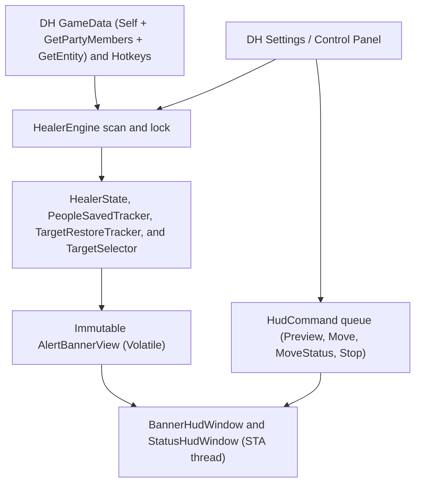

# Code architecture

## Components

All plugin C# source files live under `src/`.

| File / type | Responsibility |
| --- | --- |
| `HealersHelperPlugin.cs` / `HealersHelperPlugin` | DH `IDdoPlugin` identity, lifecycle (`Initialize`, `GetPluginUI`, `Terminate`), engine & HUD wiring |
| `Contracts.cs` | `TrackingMode`, `TargetMethod`, `BannerSeverity`, `HotkeyBinding`, `WatchedMemberSnapshot`, `AlertBannerView`, `IHealerEngineView` |
| `HealerEngine.cs` | 120 ms scan loop, self+party+entity HP merging, self-cast (`OnHotbarUsage`/`OnRunScript`/`SpellPoints_Current`) & `PeopleSaved` persistence, foreground `GetAsyncKeyState` + `EventProvider.KeyDown`, `Volatile` view snapshot |
| `HealerState.cs` | Pure threshold + recovery hysteresis, lowest-HP % prioritization, `DeadAlertSeconds` timeout/suppression, `Notice` overlay, strict `PluginEnabled=false` silence |
| `PeopleSavedTracker.cs` | Pure clutch-save detector (configurable `SelfCastWindowSeconds`, `SaveWindowSeconds`, `MinHealDelta`, `damageTaken > PreHealHp`, MaxHP cap & `InTown()` guards) |
| `TargetRestoreTracker.cs` | Pure post-heal previous-target restoration tracker (`SelectionSettleGraceSeconds`, `MaxRestoreWindowSeconds`, multi-injury chaining, manual-override cancellation, `RestoreTargetDelaySeconds`) |
| `HealerStats.cs` | Pure gamification helpers (`StreakTracker` on `LifeState.Dead`, `ReflexTracker` `50..10000ms`, `ClosestCall`/`OnePercentClub`, `RankForSaves`, pure ASCII `<= 185` `FormatChatScorecard`) |
| `TargetSelector.cs` | `SelectObject(ulong)` with `0 < id < ulong.MaxValue` and `GetSelectedObjectId().GetValueOrDefault()` guards, cooldown on `TrySelect`, cooldown-free `TryRestore` (rejecting dead non-player corpses), and `IKeymap` + `SendKey` fallback |
| `HotkeyMatcher.cs` | Pure hotkey matching and deduplication across `EventProvider.KeyDown` and `GetAsyncKeyState` |
| `Settings.cs` | Validation, clamping, atomic `.tmp` JSON persistence (`healers-helper.json`), exact integer banner (`18..140`) & status (`9..48`) pixel font sizing |
| `BannerPresentation.cs` | Pure banner text, `20..255` opacity, 6 custom `#RRGGBB` colors (preserving default ARGBs), `HudEnabled=false` live suppression, and 9-zone `ClassifyEditHit` hit-testing |
| `StatusHudPresentation.cs` | Pure compact status HUD text/color formatting (`HEALER  OFF`, `PAUSED`, `PARTY`, `FOCUS`) and drag hint |
| `BannerHudController.cs` | Dedicated STA thread hosting both `BannerHudWindow` and `StatusHudWindow`, draining `ConcurrentQueue<HudCommand>` (`Preview`, `Move`, `MoveStatus`, `Stop`) |
| `BannerHudWindow.cs` | Topmost click-through alert banner, `WDA_EXCLUDEFROMCAPTURE` (`0x11`), interactive center move + opposite-edge/corner drag resize + wheel font resize + `Ctrl+wheel` opacity (`HTCLIENT` + `MA_NOACTIVATE`) |
| `StatusHudWindow.cs` | Compact topmost click-through status HUD (`WS_EX_LAYERED \| WS_EX_TRANSPARENT \| WS_EX_NOACTIVATE \| WS_EX_TOOLWINDOW`), transparent outlined text, optional 20s drag plate |
| `NativeHud.cs` | Win32 P/Invoke, `IsWineRuntime` Wine/Proton detection & fallbacks, shared `HudHostHelper`, and reusable top-down 32bpp `Format32bppPArgb` `CreateDIBSection` + `UpdateLayeredWindow` surface |
| `HealersHelperUi.cs` | Hosted DH control panel with `FitToolbarWidth()`, `OfflineSettingsEngineView` last-state persistence, live `Plugin: ON/OFF` & `Banner: ON/OFF` & `People Saved` counters, action buttons, and compatibility note |
| `SettingsDialog.cs` | Autosized settings modal with dirty-tracked `PluginEnabled`/`HudEnabled`/`Mode` preservation, thresholds, banner & status font pixels, `20..255` opacity, 6 color swatch pickers, targeting/restore, and 7 hotkeys |

## HP collection and alert state

`IDdoGameDataProvider.GetPartyMembers()` excludes the local character and caches its `IPartyMember` getters on construction/refresh. `HealerEngine` therefore queries `GetPartyMembers()` fresh each scan, enriches each member with `GetEntity(member.Id)` (when non-null and `!IsDeleted`) for `LifeState` (`Undef=0`, `Dead=2`, `Incapacitated=3`, `Alive=4`) and live `HitPoints_Current` / `HitPoints_Max`, and merges the local character via `GetCurrentCharacterId()` and `GetCurrentCharacter()` (`PartySlotIndex = 0` for self, `1..N` for party members).

`HealerState` evaluates watched members against `HpThresholdPercent` (default 50%) and `RecoveryHysteresisPercent` (default 3%) using monotonic timestamps. When a watched player's HP is `<= 0` (including negative incapacitated HP in DDO) or `LifeState` is `Dead` or `Incapacitated`, `HealerState` raises `BannerSeverity.CriticalDown` for `DeadAlertSeconds` (default 6s) and then suppresses repeat dead flashes for that player until their HP rises above 0 and they are alive again.

## Targeting and hotkeys

`TargetSelector` prefers `SelectObject(ulong)` (`Auto` and `SdkSelectOnly`), which writes an MMF command to `dndpl.dll` without subscription gates. Because `GetSelectedObjectId()` returns `(ulong?)0` rather than `null` when nothing is selected, `TargetSelector` checks `targetId > 0 && targetId < ulong.MaxValue`, verifies `GetEntity(targetId)` is non-null and `!IsDeleted`, and compares `GetSelectedObjectId().GetValueOrDefault() != targetId` while honoring `AutoTargetCooldownSeconds` (default 3.0s). In `PartyKeyOnly`, it resolves `TARGET_SELF_KEY` or `TARGET_FELLOW_{slot}_KEY` via `IKeymap.GetHotkey` and reports unbound slots in `TargetingStatus` rather than inventing keys.

When `RestorePreviousTargetAfterHeal` (default `true`) is enabled, `TargetRestoreTracker` records the prior selected object before `TrySelect` switches to an injured ally (preserving the original target across chained multi-injury switches such as `Boss -> Alice -> Bob`). It enforces 5 strict healing-priority rules: (1) `RestoreCandidate` carries `ExpectedCurrentTargetId` verified live on entry and immediately before `SelectObject`/`SendKey` in `TargetSelector.TryRestore`; (2) during `SelectionSettleGraceSeconds` (`0.8s`), only `_originalTargetId` or `_switchedPlayerId` is tolerated while clearing or clicking any other target cancels immediately; (3) restoration holds universally whenever any alert is active or any watched, connected, non-`IsTrulyDead` ally is incapacitated or `<= HpThresholdPercent` (even if `AutoTargetOnAlert` is `false` or alert banners timed out); (4) `HealerEngine` releases leftover auto-target cooldown immediately (`IsPreviousTargetHealedOrGone`) once the prior ally recovers so a newly injured ally is selected without delay; and (5) alert auto-targeting and target restoration run in mutually exclusive branches of `EvaluateLocked`. Dead non-player corpses are rejected, and `TryRestore` never consumes auto-target cooldown.

Hotkeys listen to both `EventProvider.KeyDown` (when DH `HotKeysEnabled` is true) and a foreground-gated `GetAsyncKeyState` edge poll, deduplicated in `HotkeyMatcher` so rapid or dual notifications never double-trigger.

## Threading, native drawing, and Lossless Scaling

The engine publishes immutable `AlertBannerView` snapshots via `Volatile`. `BannerHudController` runs a separate STA WinForms message loop (`Application.Run()`), hosting both `BannerHudWindow` and `StatusHudWindow` and draining `Preview`, `Move`, `MoveStatus`, and `Stop` commands without blocking DH's UI thread on shutdown. `NativeHud` reuses a single `HDC` and top-down 32bpp `CreateDIBSection` surface per HUD window until dimensions change, presenting via `UpdateLayeredWindow` (`ULW_ALPHA = 2`, `AC_SRC_ALPHA = 1`) with zero per-frame native allocations.

Both `BannerHudWindow` and `StatusHudWindow` set `WS_EX_LAYERED | WS_EX_TRANSPARENT | WS_EX_NOACTIVATE | WS_EX_TOOLWINDOW`, request `SetWindowDisplayAffinity(Handle, 0x11)` (`WDA_EXCLUDEFROMCAPTURE`) when `ExcludeFromCapture` is enabled, read back `GetWindowDisplayAffinity`, and reassert `HWND_TOPMOST` periodically while visible. Foreground visibility permits DDO's process ID, DH's process ID, or `LosslessScaling`.

Agent counterpart: [Code map and invariants](../agents/CODE.md).
