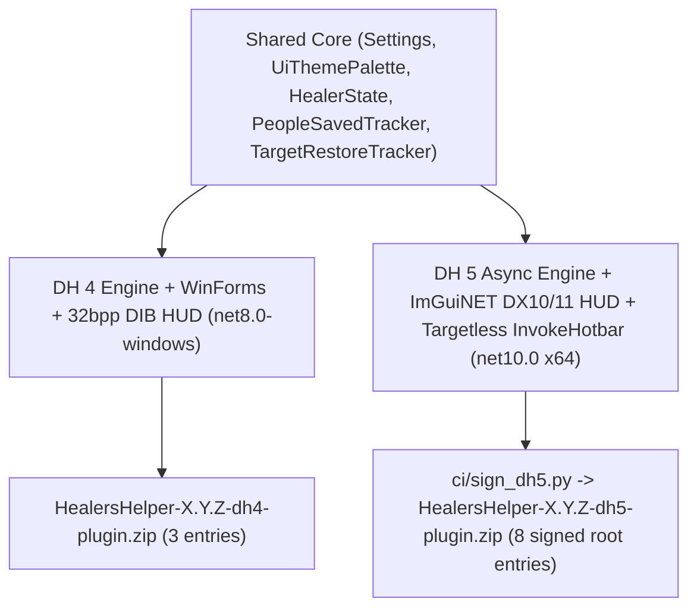

# Code architecture

## Dual-project shared-core layout

Portable core types live in `src/` and are linked directly into both `src-dh5/HealersHelper.Dh5.csproj` and `tests/HealersHelper.Tests.csproj` with zero duplicated logic:

| File / type | Host | Responsibility |
| --- | --- | --- |
| `Contracts.cs` | Shared | `TrackingMode`, `TargetMethod`, `BannerSeverity`, `HotkeyBinding`, `WatchedMemberSnapshot` (with `TempHitPoints`, `SpellPoints`, `IsIncapacitated`), `LifeStatusEvaluator`, `AlertBannerView` (`IsSoulstone`), `IHealerEngineView`, `TargetPolicy` (incl. `EvaluateRaidKeymapReadiness`) |
| `UiThemePalette.cs` | Shared | `UiTheme` (`EberronGold`, `CannithArcane`, `FeywildTwilight`) and M3 4-layer dark tonal palettes |
| `Settings.cs` | Shared | 69 validated properties (incl. `FallbackDeathHp`, default `-200`, `0` = off), atomic `.tmp` JSON persistence (`healers-helper.json`), pixel font & opacity bounds, safe `0` DH 5 Quick-Cast defaults |
| `OfflineSettingsEngineView.cs` | Shared | File-backed settings & stats persistence used when DDO is disconnected |
| `HealerState.cs` | Shared | 3-state triage priority (Incap > Living Low > Soulstone), hysteresis, TempHP effective-%, session mute filter, `SortForTriage`, `DeadAlertSeconds` suppression |
| `PeopleSavedTracker.cs`, `HealerStats.cs` | Shared | Clutch saves (`damageTaken > PreHealHp`), deathless streak (`LifeState.Dead` only), 8 prestige ranks, reflex timer (`50..10000 ms`), pure ASCII `<= 185` scorecard |
| `TargetRestoreTracker.cs`, `HotkeyMatcher.cs` | Shared | 5-rule healing-priority target restoration and ~250 ms deduplicated hotkey matcher |
| `BannerPresentation.cs`, `StatusHudPresentation.cs` | Shared | Custom 6 hex colors, calm Spectral Violet Soulstone banner (`#2A1538` / `#D8DCE6`), `HudEnabled=false` suppression, 9-zone resize hit testing |
| `HealersHelperPlugin.cs`, `HealerEngine.cs`, `TargetSelector.cs` | DH 4 | `IDdoPlugin`, 120 ms scan loop, `GetPartyMembers()` + self + `GetEntity` (`HitPoints_Temp`, `LifeState`), `SelectObject`/`IKeymap`, hybrid hotkeys |
| `BannerHudController.cs`, `BannerHudWindow.cs`, `StatusHudWindow.cs`, `NativeHud.cs`, `HealersHelperUi.cs`, `SettingsDialog.cs` | DH 4 | STA layered 32bpp DIB HUDs (`WDA_EXCLUDEFROMCAPTURE`, `IsWineRuntime`, spatial HP/THP bar, 20s move/resize/wheel/opacity) + themed WinForms UI |
| `src-dh5/Dh5Plugin.cs`, `Dh5HealerEngine.cs`, `Dh5HealersHelperUi.cs` | DH 5 Beta | `VoK.Sdk.IPlugin` (`5.3.0.0`), non-blocking `TickAsync()` + `UpdateProperties([0x10000E0Cu, 0x10001868u, 0x10008250u])`, `eventProvider.Party`, targetless `InvokeHotbar`, `/hh` chat commands (incl. `/hh deathhp`), `ImGuiNET` banner + status HUD + optional `>=28px` Triage Raid HUD + 5-tab themed M3 window |

## Key behavioral details

- **3-State Life/Death Triage & TempHP:** In DDO, unconscious range scales well past `-10 HP` via Diehard, feats, enhancements, Epic Past Lives, and gear. `LifeStatusEvaluator` uses authoritative live `LifeState` + `Death_SoulStoneID` (`0x10001868`) in entity range (keeping `LifeState.Incapacitated` healable at any negative HP) and falls back out of range to sticky confirmed-dead latching -> cached `HitPoints_IncapacitatedBonus` (`0x10008250`, personal floor `-10 - bonus`) -> configurable `FallbackDeathHp` (default `-200`, `0` = disabled). Incapacitated allies always outrank Living Low HP allies, which always outrank Dead Soulstones (calm Spectral Violet `DEAD — RAISE`, never auto-targeted ahead of a living ally). `HitPoints_Temp` surfaces as `+N THP` in Sovereign Gold (`#F5C542`) on banners and Raid HUD bars.
- **DH 4 vs DH 5 Targeting:** DH 4 selects via `SelectObject(ulong)` (`Auto` / `SdkSelectOnly`) with `TargetRestoreTracker`'s 5 rules (`ExpectedCurrentTargetId`, `0.8 s` settle grace, universal hold while any living ally needs healing, instant cooldown release, mutually exclusive branches). DH 5 preserves all of that AND adds targetless `InvokeHotbar(bar, slot, targetId)` Quick-Heal/Quick-Raise (left-click Raid HUD row, `/hh heal`, or `QuickCastCriticalHotkey`) without dropping Boss/Tank hard targets.
- **DH 5 Threading & `LifeState` Hydration:** `Dh5HealerEngine` runs `TickAsync()` via a non-reentrant ThreadPool timer, awaits `UpdateProperties([0x10000E0Cu, 0x10001868u, 0x10008250u])` on each watched entity so `LifeState`, `Death_SoulStoneID`, and `HitPoints_IncapacitatedBonus` stay live across deaths/raises and out-of-range transitions, tracks party connection/leave/disband events via `eventProvider.Party` (clearing/pruning `_confirmedDeadIds` and `_cachedIncapBonus`), and publishes immutable `AlertBannerView` snapshots read lock-free by `ImGui_Render()`.

Agent counterpart: [Code map and invariants](../agents/CODE.md).
