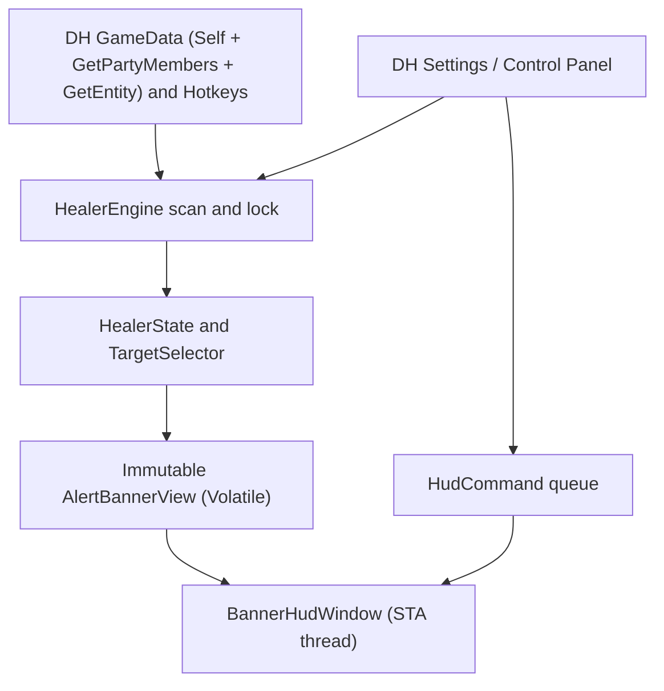

# Code architecture

## Components

All plugin C# source files live under `src/`.

| File / type | Responsibility |
| --- | --- |
| `HealersHelperPlugin.cs` / `HealersHelperPlugin` | DH `IDdoPlugin` identity, lifecycle (`Initialize`, `GetPluginUI`, `Terminate`), engine & HUD wiring |
| `Contracts.cs` | `TrackingMode`, `TargetMethod`, `BannerSeverity`, `HotkeyBinding`, `WatchedMemberSnapshot`, `AlertBannerView`, `IHealerEngineView` |
| `HealerEngine.cs` | 120 ms scan loop, self+party+entity HP merging, self-cast (`OnHotbarUsage`/`OnRunScript`/`SpellPoints_Current`) & `PeopleSaved` persistence, foreground `GetAsyncKeyState` + `EventProvider.KeyDown`, `Volatile` view snapshot |
| `HealerState.cs` | Pure threshold + recovery hysteresis, lowest-HP % prioritization, `DeadAlertSeconds` timeout/suppression, `Notice` overlay, strict `PluginEnabled=false` silence |
| `PeopleSavedTracker.cs` | Pure clutch-save detector (`SelfCastWindowSeconds=3.5`, `SaveWindowSeconds=5.0`, `MinHealDelta=5`, `damageTaken > PreHealHp`, `InTown()` guard) |
| `TargetSelector.cs` | `SelectObject(ulong)` with `0 < id < ulong.MaxValue` and `GetSelectedObjectId().GetValueOrDefault()` guards, cooldown, and `IKeymap` + `SendKey` fallback |
| `HotkeyMatcher.cs` | Pure hotkey matching and deduplication across `EventProvider.KeyDown` and `GetAsyncKeyState` |
| `Settings.cs` | Validation, clamping, atomic `.tmp` JSON persistence (`healers-helper.json`), exact integer banner (`18..140`) & status (`9..48`) pixel font sizing |
| `BannerPresentation.cs` | Pure banner text, color/flash phase (`FlashIntervalMs`), `CriticalDown`/`LowHp`/`Notice`/`Editing` computation |
| `StatusHudPresentation.cs` | Pure compact status HUD text/color formatting (`HEALER  OFF`, `PAUSED`, `PARTY`, `FOCUS`) and drag hint |
| `BannerHudController.cs` | Dedicated STA thread hosting both `BannerHudWindow` and `StatusHudWindow`, draining `ConcurrentQueue<HudCommand>` (`Preview`, `Move`, `MoveStatus`, `Stop`) |
| `BannerHudWindow.cs` | Topmost click-through alert banner, `WDA_EXCLUDEFROMCAPTURE` (`0x11`), `WM_NCHITTEST`, foreground PID / LS checks, monitor-relative drag |
| `StatusHudWindow.cs` | Compact topmost click-through status HUD (`WS_EX_LAYERED \| WS_EX_TRANSPARENT \| WS_EX_NOACTIVATE \| WS_EX_TOOLWINDOW`), transparent outlined text, optional 20s drag plate |
| `NativeHud.cs` | Win32 P/Invoke, shared `HudHostHelper`, and reusable top-down 32bpp `Format32bppPArgb` `CreateDIBSection` + `UpdateLayeredWindow` surface |
| `HealersHelperUi.cs` | Hosted DH control panel with `FitToolbarWidth()`, live `Plugin: ON/OFF` & `People Saved` counters, action buttons, and members list |
| `SettingsDialog.cs` | Autosized settings modal for master toggle, mode, thresholds, banner & status font pixels, flash interval, targeting, Lossless Scaling capture exclusion, and click-to-record hotkeys |

## HP collection and alert state

`IDdoGameDataProvider.GetPartyMembers()` excludes the local character and caches its `IPartyMember` getters on construction/refresh. `HealerEngine` therefore queries `GetPartyMembers()` fresh each scan, enriches each member with `GetEntity(member.Id)` (when non-null and `!IsDeleted`) for `LifeState` (`Undef=0`, `Dead=2`, `Incapacitated=3`, `Alive=4`) and live `HitPoints_Current` / `HitPoints_Max`, and merges the local character via `GetCurrentCharacterId()` and `GetCurrentCharacter()` (`PartySlotIndex = 0` for self, `1..N` for party members).

`HealerState` evaluates watched members against `HpThresholdPercent` (default 50%) and `RecoveryHysteresisPercent` (default 3%) using monotonic timestamps. When a watched player's HP is `<= 0` (including negative incapacitated HP in DDO) or `LifeState` is `Dead` or `Incapacitated`, `HealerState` raises `BannerSeverity.CriticalDown` for `DeadAlertSeconds` (default 6s) and then suppresses repeat dead flashes for that player until their HP rises above 0 and they are alive again.

## Targeting and hotkeys

`TargetSelector` prefers `SelectObject(ulong)` (`Auto` and `SdkSelectOnly`), which writes an MMF command to `dndpl.dll` without subscription gates. Because `GetSelectedObjectId()` returns `(ulong?)0` rather than `null` when nothing is selected, `TargetSelector` checks `targetId > 0 && targetId < ulong.MaxValue`, verifies `GetEntity(targetId)` is non-null and `!IsDeleted`, and compares `GetSelectedObjectId().GetValueOrDefault() != targetId` while honoring `AutoTargetCooldownSeconds` (default 3.0s). In `PartyKeyOnly`, it resolves `TARGET_SELF_KEY` or `TARGET_FELLOW_{slot}_KEY` via `IKeymap.GetHotkey` and reports unbound slots in `TargetingStatus` rather than inventing keys.

Hotkeys listen to both `EventProvider.KeyDown` (when DH `HotKeysEnabled` is true) and a foreground-gated `GetAsyncKeyState` edge poll, deduplicated in `HotkeyMatcher` so rapid or dual notifications never double-trigger.

## Threading, native drawing, and Lossless Scaling

The engine publishes immutable `AlertBannerView` snapshots via `Volatile`. `BannerHudController` runs a separate STA WinForms message loop (`Application.Run()`), draining `Preview`, `Move`, and `Stop` commands without blocking DH's UI thread on shutdown. `NativeHud` reuses a single `HDC` and top-down 32bpp `CreateDIBSection` surface until dimensions change, presenting via `UpdateLayeredWindow` (`ULW_ALPHA = 2`, `AC_SRC_ALPHA = 1`) with zero per-frame native allocations.

`BannerHudWindow` sets `WS_EX_LAYERED | WS_EX_TRANSPARENT | WS_EX_NOACTIVATE | WS_EX_TOOLWINDOW`, requests `SetWindowDisplayAffinity(Handle, 0x11)` (`WDA_EXCLUDEFROMCAPTURE`) when `ExcludeFromCapture` is enabled, reads back `GetWindowDisplayAffinity`, and reasserts `HWND_TOPMOST` periodically while visible. Foreground visibility permits DDO's process ID, DH's process ID, or `LosslessScaling`.

Agent counterpart: [Code map and invariants](../agents/CODE.md).
